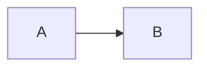

# paarth.me

My personal website and blog, built with [Hugo](https://gohugo.io/). It's deliberately plain: hand-written Go templates, inline styles, system fonts, no theme and no build pipeline.

Live site: https://paarth-sharma.vercel.app/

## What's in here

- **Blog** – longer write-ups (OMV 7 home server, Pi-hole, GrapheneOS, etc.)
- **Zines** – printable, ASCII-style visual guides
- **Code** – my starred GitHub repos, grouped by category (driven by a YAML file)
- **Games, music, links, now, uses, colophon, changelog** – the usual personal-site pages
- **Projects** – split into current and past using the `status` front matter field

## Requirements

- [Hugo](https://gohugo.io/installation/) (a recent version; the standard build is enough, extended isn't needed since there's no SCSS)
- Git
- An internet connection when viewing pages with diagrams. Mermaid is loaded from the jsDelivr CDN.

Install Hugo:

```bash
# macOS
brew install hugo

# Windows
winget install Hugo.Hugo.Extended

# Arch
sudo pacman -S hugo
```

Check it worked:

```bash
hugo version
```

## Run it locally

```bash
git clone https://github.com/paarth-sharma/paarth.me.git
cd paarth.me
hugo server -D
```

Then open http://localhost:1313. The server live-reloads when you edit anything. `-D` includes drafts.

## Build for production

```bash
hugo --gc --minify
```

The finished site lands in `public/`. That folder is generated, so don't edit it or commit it.

## Project layout

```
hugo.toml            Site config and the main nav menu
archetypes/          Templates used by `hugo new` (blog, projects, default)
content/             All pages, written in Markdown
  blog/              Blog posts
  projects/          Project pages (use status: "current" or "completed")
  zines/             Zine pages
data/
  starred_repos.yaml Feeds the /code/ page
  videos.yaml        "Latest videos" on the home page
  zines.yaml         "Latest zines" on the home page
layouts/
  index.html         Home page
  _default/          Base template, list, single, and the code page layout
  partials/          Navigation
  projects/list.html Current vs past projects layout
static/              Images and other static files (served from /)
```

## Writing content

New blog post:

```bash
hugo new blog/my-post.md
```

New project:

```bash
hugo new projects/my-project.md
```

Posts start with `draft: false` from the archetype. Flip it to `true` to hide a post from production builds while you work on it.

### Adding a page to the nav

Add a block to `hugo.toml`:

```toml
[[menu.main]]
  name = "photos"
  url = "/photos/"
  weight = 5
```

Lower weight means higher in the menu.

### Home page lists

- **Latest posts** shows the six most recent blog posts, except the two filenames listed in `$excludeFiles` in `layouts/index.html` (the OMV and Pi-hole guides, since they have their own zines).
- **Latest zines** and **latest videos** come from `data/zines.yaml` and `data/videos.yaml`. Add an entry there to show it on the home page.

### Code page

Edit `data/starred_repos.yaml`. Each category has a name, a description, and a list of repos with `name`, `url` and `description`.

### Diagrams

Use a fenced `mermaid` code block in any Markdown file:

````

````

`layouts/_default/baseof.html` converts those blocks into rendered diagrams in the browser.

## Deploying

The site is hosted on Vercel. Settings that matter:

- Framework preset: Hugo
- Build command: `hugo --gc --minify`
- Output directory: `public`
- Environment variable `HUGO_VERSION` set to the version you develop with, so builds match your local output

`baseURL` in `hugo.toml` should match the deployed domain. `hugo server` ignores it, so local development works either way.

## Known rough edges

- Some pages still contain template placeholder text. I'll get around to it sometime in the future. The site moves with me.

## License

Content is licensed under [CC BY 4.0](https://creativecommons.org/licenses/by/4.0/) unless noted otherwise.